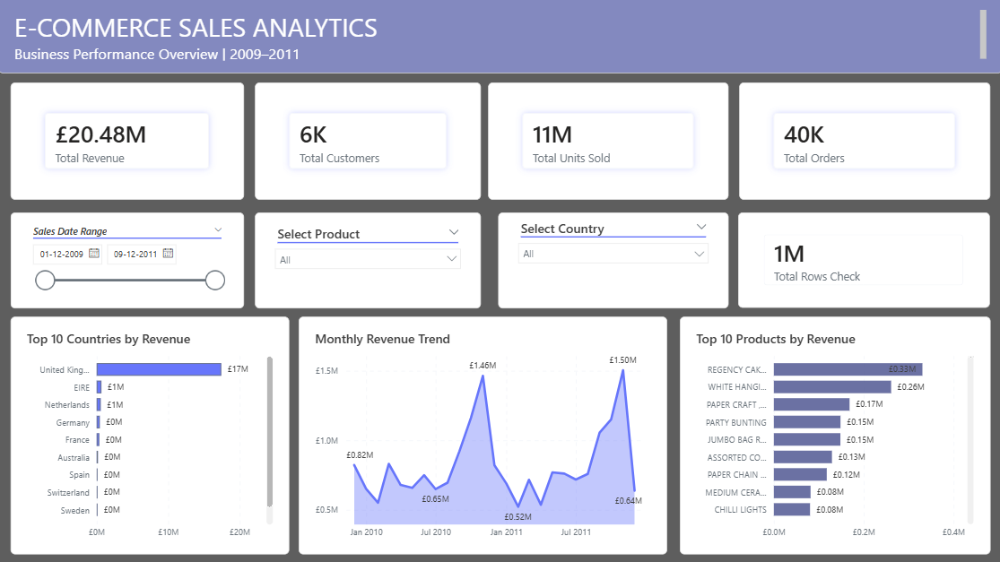
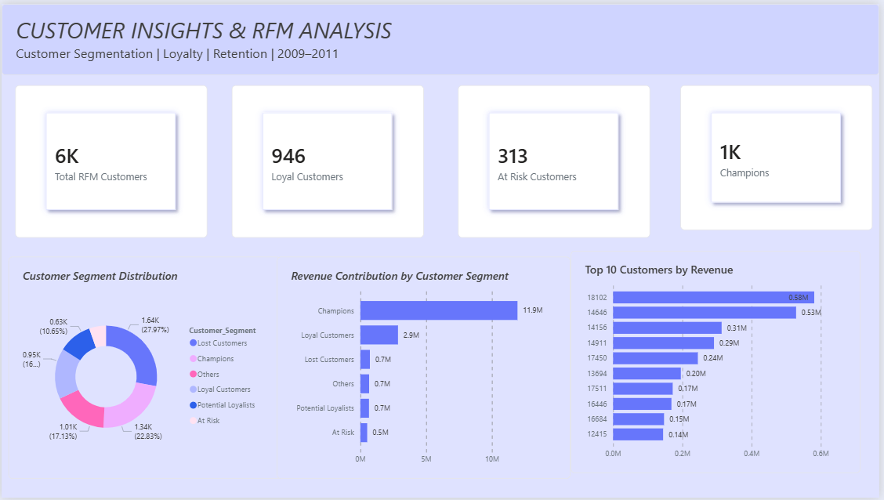

# E-Commerce Business Analytics

An end-to-end data analytics project focused on understanding e-commerce sales performance, customer purchasing behaviour, revenue trends and customer retention using Python, MySQL, SQL and Power BI.

## Project Overview

This project analyses the UCI Online Retail II dataset, covering transactions from 2009 to 2011. It transforms raw transaction data into meaningful business insights through data cleaning, SQL analysis, customer segmentation and interactive Power BI dashboards.

## Objectives

- Analyse overall sales and revenue performance.
- Identify top-performing countries and products.
- Understand customer purchasing patterns.
- Analyse repeat and one-time customers.
- Perform RFM (Recency, Frequency, Monetary) customer segmentation.
- Identify loyal, high-value and at-risk customers.

## Tools & Technologies

- Python – Data cleaning and preprocessing
- Pandas – Data manipulation and analysis
- Jupyter Notebook – Exploratory data analysis
- MySQL – Data storage
- SQL – Business queries and customer analytics
- Power BI – Interactive dashboards
- Excel – Initial data inspection

## Project Workflow

1. **Data Collection:** Obtained the Online Retail II dataset.
2. **Data Cleaning:** Handled missing descriptions, duplicate records, cancelled transactions, returns and invalid prices.
3. **Data Processing:** Used Python and Pandas to prepare the sales dataset.
4. **Database Management:** Imported cleaned sales transactions into MySQL.
5. **SQL Analysis:** Performed monthly revenue, product, country and customer analysis.
6. **RFM Segmentation:** Calculated Recency, Frequency and Monetary values and assigned customer segments.
7. **Dashboard Development:** Created interactive Power BI dashboards to communicate business insights.

## Power BI Dashboards

### 1. E-Commerce Sales Analytics

Analyses business performance through:
- Total revenue, customers, units sold and orders
- Top 10 countries by revenue
- Monthly revenue trends
- Top 10 products by revenue
- Date, product and country filters

### 2. Customer Insights & RFM Analysis

Analyses customer behaviour through:
- Customer segment distribution
- Revenue contribution by customer segment
- Top 10 customers by revenue
- Champions, Loyal Customers, Potential Loyalists, At Risk, Lost Customers and Others

)

## Key Business Insights

- Total sales revenue was approximately **£20.48 million**.
- Approximately **11.2 million units** were sold.
- The United Kingdom was the leading country by revenue.
- Customer-level RFM analysis identified **5,878 customers** with available customer IDs.
- Champions contributed approximately **£11.95 million** in identified-customer revenue.
- Loyal Customers contributed approximately **£2.86 million**.
- The RFM analysis highlights opportunities to improve retention among at-risk and lost customers.

## RFM Customer Segmentation

| Customer Segment | Customers |
|---|---:|
| Champions | 1,342 |
| Loyal Customers | 946 |
| Lost Customers | 1,644 |
| Others | 882 |
| Potential Loyalists | 626 |
| At Risk | 438 |
| **Total** | **5,878** |

Note: Overall sales revenue includes transactions without customer IDs. RFM revenue covers only identified customers, so the two revenue totals are different.

## Project Structure

text
## Project Structure

Ecommerce-Business-Analytics/
│
├── dataset/
│   ├── raw/
│   │   └── online_retail_II.xlsx
│   │
│   └── processed/
│       ├── cancellations.csv
│       ├── cleaned_sales.csv
│       ├── customer_rfm_analysis.csv
│       ├── data_quality_report.xlsx
│       ├── invalid_price_records.csv
│       └── returns_analysis.csv
│
├── Python/
│   └── data_cleaning_and_analysis.ipynb
│
├── SQL_Analysis/
│   ├── 01_Monthly_Revenue_Analysis.sql
│   ├── 02_Top_10_Products.sql
│   ├── 03_Country_Wise_Analysis.sql
│   └── 04_Customer_Analytics_RFM.sql
│
├── PowerBI/
│   ├── Ecommerce_Business_Analytics.pbix
│   └── Ecommerce_Business_Analytics_Report.pdf
│
├── Screenshots/
│   ├── sales_dashboard.png
│   └── rfm_dashboard.png
│
└── README.md

Dataset

Source: UCI Machine Learning Repository – Online Retail II

https://archive.ics.uci.edu/dataset/502/online+retail+ii

The original dataset can be downloaded from the source above.

 Skills Demonstrated

- Data Cleaning and Preprocessing
- Exploratory Data Analysis
- Python and Pandas
- MySQL and SQL
- Window Functions and CTEs
- RFM Customer Segmentation
- Power BI Dashboard Development
- Data Visualization
- Business Intelligence and Analytical Thinking

Project Outcome

Developed an end-to-end e-commerce analytics solution that converts raw transaction data into business insights, helping understand sales performance, customer value and retention opportunities.
